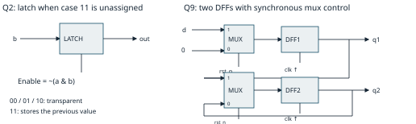

# ECE551 crash course: think hardware, then write HDL

Built from the material in this folder: all 14 lecture PDFs (00–12, including both lecture 12 parts), Exercises 03–13, HW1–3, the Cummings paper, source code, testbenches, diagrams, screenshots, and simulation transcripts. Duplicate files were consolidated. Generated waveforms and compiled simulation files support the examples; they are not additional topics. The folder has no standalone Ex01/Ex02 handouts or HW1 assignment PDF, so HW1 coverage comes from its structural flip-flop, testbench, ZIP, and screenshot.

The strongest guide to exam style is **Exams/MidtermPractice_sol.pdf**, a **Spring 2020** exam. Its final FSM problem is worth 18 points, the largest individual problem. Your Fall 2026 homework uses UART and Segway control rather than the old exam's SPI master. Similar question *types* are a useful study priority; actual questions and coverage are unknown. This guide covers everything available, including the newer FIFO exercise.

Use the separate **ECE551_Midterm_Cheat_Sheet.pdf** for the dense two-page reference. The old exam allows one 8½ × 11 sheet; it does not establish this year's rules or whether both sides are allowed. The reference is formatted for one sheet printed on both sides if permitted.

## 1. Study in this order

| Priority | What you should be able to do without notes | Main folder sources |
|---|---|---|
| First | Identify muxes, latches, flops, enables, reset type, feedback | Lectures 07/10; Ex08; practice Q2/Q8/Q9/Q14 |
| First | Hand-trace blocking/nonblocking code, delayed assignments, races | Lectures 06/09/10; Cummings; practice Q3/Q4/Q6/Q7 |
| First | Turn a written protocol into an FSM and datapath | Lecture 11; HW3 steering; Ex11/12; practice Q16 |
| Next | Extend, shift, add, detect overflow, saturate signed values | Lectures 02/03; Ex04–07; HW2; practice Q1/Q5 |
| Next | Synchronize an input, detect an edge, shift a pattern, write a sticky flag | Ex03/08/09/12; practice Q11/Q12 |
| Next | Recognize and explain PWM/UART/PID | Ex06/07/09–12; HW3; practice Q14 |
| Cover | Build self-checks and timeouts; tasks/functions/assertions/FIFO | Lectures 05/08/12; Ex13; practice Q13 |
| Cover | Explain design flow, technology choice, timing budgets | Lecture 01; practice Q1/Q15 |

If you have about four hours: spend 45 minutes on hardware inference, 45 on simulation, 45 on arithmetic, 45 on FSM/UART/PWM, 20 on FIFO/testbenches, and 40 redoing the practice exam with the cheat sheet. More time should go to solving problems from a blank page rather than rereading syntax.

## 2. The class's central idea: code describes a circuit

An HDL module describes hardware that operates in parallel. A testbench describes a sequence of simulation events. Each `always`, `initial`, gate instance, and continuous assignment is a concurrent process. Statements *within* a procedural block have an order; separate blocks at the same time have no general execution order.

The design flow is specification → planning/block diagram → HDL → functional simulation → synthesis → netlist verification → placement/routing → parasitic extraction/timing checks → hardware validation. A netlist is a list of cells and their connections. Synthesis uses a cell library and constraints to choose an implementation. Writing `#5` in RTL does not request a physical five-nanosecond circuit.

| Description | Example | Typical hardware |
|---|---|---|
| Structural | `and g1(y,a,b);` | Named gates or instantiated modules |
| Dataflow | `assign y = sel ? a : b;` | Combinational mux |
| Behavioral combinational | `always_comb` with complete assignments | Gates, arithmetic, muxes |
| Behavioral sequential | `always_ff @(posedge clk)` | Edge-triggered state plus its input logic |

Technology choice: full custom maximizes implementation control but requires the most effort; standard-cell ASICs suit large-volume, fixed hardware; FPGAs support programmable parallel logic and quick development; microcontrollers suit work achievable with software and available peripherals. In the practice Honda scenario, the expected answer is a standard-cell ASIC because of production volume and specialized serial interfaces. That is the problem's engineering tradeoff, not a universal prohibition on implementing custom protocols in software.

Module connections should normally use names: `adder #(.WIDTH(16)) u(.a(A), .b(B), .sum(S));`. Gate primitives put outputs first: `nand #5 g(n1,en,out);`. `bufif1(out,in,en)` drives `in` when enabled and `z` otherwise; `notif1` also inverts. HW1's master/slave DFF is built from inverting tristate stages and weak feedback keepers: the master is transparent while clock is low, and the slave while clock is high, producing rising-edge storage.

## 3. Types, operators, and bits you must keep straight

`wire` is a resolved net, useful for multiple drivers; `reg` is a legacy procedural variable and does **not** mean a physical register. `logic` is the usual SystemVerilog four-state variable type and can be used with a single continuous driver or a procedural driver. For a question requiring legacy `reg` versus `wire`, use `reg` for a procedural LHS and `wire` for continuous/gate-driven signals. Use `wire` for a genuinely multiply driven bus.

Four states: `0`, `1`, `x` (unknown), `z` (undriven/high impedance). Equal-strength drivers that disagree resolve to `x`; a stronger known driver wins against a weaker one; a `z` driver contributes no driven value. Strength order is supply > strong > pull > weak > highz. A known zero dominates AND (`0 & x = 0`), and a known one dominates OR (`1 | x = 1`). In ordinary logic, `z` behaves as unknown.

| Operator | Meaning | Example |
|---|---|---|
| `&`, `\|`, `^`, `~` | Bitwise logic | `8'hA5 & 8'h0F = 8'h05` |
| `&&`, `\|\|`, `!` | Boolean tests; one-bit result | `4'b0011 && 4'b1110 = 1` |
| unary `&v`, `\|v`, `^v` | Reduction: all ones / any ones / odd parity | `~\|cnt` means count is zero |
| `==`, `!=` | Logical equality; may return `x` | `4'b10x1 == 4'b1001` gives `x` |
| `===`, `!==` | Case equality; compares x/z literally | Useful for testbench failures |
| `<<`, `>>` | Zero-filling shifts | Shift width comes from the expression/context |
| `>>>` | Sign-filling only if the left operand is signed | `$signed(4'b1001) >>> 2 = 4'b1110` |
| `?:` | Select a result | Mux; unknown select merges corresponding branch bits |

Numbers are `width'basevalue`, with optional `s` for signed: `8'hFF`, `8'shFF` (−1), `5'sd9`. An undersized literal truncates high bits. Unsized decimal numbers are normally at least 32-bit signed, so explicit widths prevent surprises. `'0` and `'1` fill the destination with zeros or ones.

**Signed range:** an N-bit two's-complement value spans −2^(N−1) through 2^(N−1)−1. Unsigned spans 0 through 2^N−1. A mixed signed/unsigned arithmetic or relational expression generally uses unsigned interpretation. Casting only one operand is often insufficient. Concatenations and part-selects are unsigned expressions, even if their source vector is signed. `$signed` changes interpretation, not width.

```systemverilog
// Select sign extension versus zero extension, practice Q5.
assign vec16 = SE ? {{8{vec8[7]}},vec8} : {8'h00,vec8};
// Keep the carry in an unsigned four-bit adder.
assign {co,Sum} = {1'b0,A} + {1'b0,B} + cin;
// Shift in a new newest bit at bit 0; the oldest bit falls out.
assign next_shift = {shift_reg[6:0],in_stream};
// Rotate right, preserving the bit that would otherwise fall out.
assign rotated = {value[0],value[15:1]};
```

N-bit plus N-bit needs N+1 bits to preserve the full result. A full N×M multiply needs up to N+M bits. Widen *before* an operation whose result might overflow; putting a narrow intermediate into a wider destination later cannot restore lost bits. Expressions are affected by context, so explicitly sized intermediates are the easiest paper solution.

Arithmetic shift and signed division round differently for negative fractions: `-65 >>> 6` is −2; `-65 / 64` is −1 because division truncates toward zero. Ex06 drops low bits, so use the arithmetic-shift result. Negating the most-negative N-bit value in N bits overflows; extend first if that case is possible.

## 4. Arithmetic, overflow, saturation, and the Segway datapath

Carry and signed overflow answer different questions. For N-bit addition, signed overflow occurs when the operands have the same sign and the result has the opposite sign. For subtraction, overflow occurs when operands have opposite signs and the result's sign differs from A.

```systemverilog
assign ov_add = ~(A[N-1]^B[N-1]) & (S[N-1]^A[N-1]);
assign ov_sub =  (A[N-1]^B[N-1]) & (S[N-1]^A[N-1]);
// Add/sub datapath: B xor SUB, plus carry-in SUB.
assign S = A + (B ^ {N{SUB}}) + SUB;
```

Ex04's good bug-catching vector: −128 − 1 = −129 cannot fit in eight bits. The output wraps to `8'h7F`, and overflow must be 1. Also test 127+1, −128+(−1), −1+1, and subtraction of opposite signs. HW2's four-bit unsigned adder has 2^9 = 512 input combinations; Ex04's eight-bit add/sub block has 2^17 = 131,072.

**Saturation** clips an out-of-range value to the closest representable bound; truncation wraps it. For unsigned W→N, overflow exists when any discarded bit is 1. For signed W→N, all bits from W−1 down through N−1 must match the original sign to fit. Include the *new sign bit* N−1 in the check.

```systemverilog
// HW2 / Ex05, unsigned 16 -> 10.
assign usat = |u[15:10] ? 10'h3FF : u[9:0];
// Signed 16 -> 10, bounds [-512,511].
assign ssat = (!s[15] && |s[14:9]) ? 10'h1FF :
              (s[15] && ~&s[14:9]) ? 10'h200 : s[9:0];
// Signed 10 -> 7, bounds [-64,63].
assign dsat = (!d[9] && |d[8:6]) ? 7'h3F :
              (d[9] && ~&d[8:6]) ? 7'h40 : d[6:0];
```

Common trap: 10-bit signed +512 is out of range although it fits in ten *unsigned* bits. Saturating +512 gives +511, not −512. Saturating −513 gives −512. Boundary tests should include min−1, min, min+1, −1, 0, max−1, max, max+1.

**PID math, Ex06 and HW3:** `e = sat10(ptch)`, `P = 9e`, `I = floor(integrator/64)`, `D = -floor(ptch_rt/64)`, and `PID_cntrl = sat12(P+I+D)`. The derivative here uses the gyro's pitch-rate signal; it is not a difference of stored pitch samples. P/I use 15 bits, D uses 13, and their sign-extended sum uses 16 before clipping to [−2048,2047]. For example, pitch=100, integrator=640, pitch-rate=128 gives 900+10−2=908.

HW3 adds an 18-bit integrator register: reset or rider-off clears it; otherwise a valid sample adds saturated error only if the addition does not overflow. A rejected addition **holds** the old accumulator, rather than clamping it to the rail. Its soft-start timer is 27 bits, held at zero while power is off, and frozen when bits [26:19] are all ones. `ss_tmr = long_tmr[26:19]`; the terminal value first occurs at 255×2^19 = 133,693,440 clocks, about 2.674 seconds at 50 MHz.

**SegwayMath, Ex07:** multiply signed PID by a zero-extended, signed interpretation of unsigned `ss_tmr`, then drop eight low bits. Clip the steering potentiometer to [0x200,0xE00], subtract 0x7FF, multiply by 3, and drop four low bits. Add steering to left torque and subtract it from right torque when enabled. Use 13-bit signed torque intermediates. If |torque| < 42, multiply by 4; otherwise add 168 to positive torque or subtract 168 from negative torque. Power-off forces shaped torque to zero. Finally saturate each speed to 12 signed bits. `too_fast` is true when either signed speed is **greater than +1536**, not when its absolute magnitude is large.

Useful example: PID=256, timer=128 gives base drive 128. Centered steering gives zero steering term; dead-band compensation makes each speed 296. At PID=−1 and timer=128, dropping low bits produces −1, not zero.

## 5. Read RTL and draw the circuit

Use this procedure: identify the trigger → mark each signal that stores state → write its update/hold equation → draw the combinational expression feeding its input → add muxes for conditionals → label reset and enable priority.

| Code pattern | Inferred behavior |
|---|---|
| Complete `always_comb` / `assign` | Combinational logic |
| Incomplete level-sensitive assignment | Latch: transparent when assigned, holds otherwise |
| Clock-edge assignment | Flip-flop; omitted branches are hold/enable |
| `if (a) ... else if (b) ...` | Selection with a higher priority than b |
| Register `q <= q + 1` at a clock edge | Counter: incrementer + mux + flops |
| `q = q + 1` in combinational logic | Self-dependent feedback; not a clocked counter |

```systemverilog
// Active-high synchronous reset: acts only at a rising edge.
always_ff @(posedge clk)
  if (rst) q <= 1'b0;
  else     q <= d;

// Asynchronous active-low reset, synchronous enable.
always_ff @(posedge clk or negedge rst_n)
  if (!rst_n) q <= 1'b0;
  else if (en) q <= d;  // otherwise a flop holds, not a latch

// SR-style flop: asynchronous reset; synchronous clear beats set.
always_ff @(posedge clk or negedge rst_n)
  if (!rst_n) q <= 1'b0;
  else if (R) q <= 1'b0;
  else if (S) q <= 1'b1;
```

Do not put a synchronous clear into the asynchronous reset test: `if (!rst_n | clear)` with sensitivity only to `negedge rst_n` is the practice Q14 synthesis problem. Use separate `if (!rst_n)` and `else if (clear)` clauses. The missing final `else` in a clocked block is a normal hold.

**Practice Q9:** the code resets q1 but omits q2 in that branch. Therefore `D1 = rst_n ? d : 0`, `D2 = rst_n ? q1 : q2`. Draw two rising-edge DFFs, a reset-to-zero mux before q1, and a feedback mux before q2. Reset is synchronous because `rst_n` is not in the sensitivity list. q2 holds during reset and may remain unknown after power-up.

**Practice Q2:** `casez({a,b})` has `01: out=~a; z0: out=b;` and no default. For known inputs, 00→0, 01→1, 10→0, 11→hold. A valid circuit is a latch with `D=b` and enable `~(a&b)`. The procedural type is `reg` (or SV `logic`). The outer `begin/end` is optional because the entire `case` is one statement. Missing coverage creates storage even inside `always_comb`; the keyword can diagnose the mistake, not make the description complete.



`case` matches x/z exactly. `casez` treats z/? as wildcards in either expression or items; `casex` additionally treats x as a wildcard and can hide uninitialized-input bugs. `case (...) inside` places wildcard patterns in items. First matching item wins. `unique` declares mutually exclusive choices and enables checks/optimization; `priority` declares priority and expects a match unless a default is present. Defaults still matter for complete assignments and safe behavior.

Ex08's latch with `always @(clk)` is missing `d` from sensitivity: when clk stays high, changing d must change q. Use `always_latch if (en) q <= d;` or a complete level-sensitive list. `always_ff` expresses intent and imposes restrictions; it does not insert a clock, fix invalid RTL, or prevent optimization from removing unused/constant state.

## 6. Simulation: evaluation time and update time

For the course's simplified queue: active events → inactive events from `#0` → nonblocking updates → monitor/postponed observations. New active events can result from updates, so repeat processing until the time slot settles, then advance to the next scheduled time. This is a useful teaching model; SystemVerilog has additional regions, notably for assertion sampling.

Blocking `=` updates before the next statement in the same block. Nonblocking `<=` evaluates its RHS when encountered and schedules its LHS update in the NBA region. Thus `q1<=d; q2<=q1;` captures d into q1 and **old q1** into q2. In `q1=d; q2=q1;`, q2 sees the newly assigned q1 in that process.

| At time t | RHS sampled | LHS updated | Process continues |
|---|---|---|---|
| `#5 q = d;` | t+5 | t+5, active | t+5 |
| `q = #5 d;` | t | t+5, active | t+5 |
| `q <= #5 d;` | t | t+5, NBA | t |
| `#5 q <= d;` | t+5 | t+5, NBA | t+5 after scheduling |

Do a hand trace by recording **time, process, sampled RHS, scheduled update**. Never reevaluate the RHS of a pending intra-assignment delay just because its input later changes.

Example: initially a=3, b=2, c=1. At a clean clock event, `b<=a+a; c<=#5 b+a; d<=#2 c+a;` schedules b=6 now, d=4 at +2, c=5 at +5. If instead you write `b<=a+a; #5 c<=b+a; #2 d<=c+a;`, b becomes 6 now, c=9 at +5, d=12 at +7.

Two useful sequential patterns from the Cummings paper: `a<=b; b<=a;` swaps old values without a temporary; an XOR-feedback shift register (LFSR) also needs all feedback computed from old state, for example `q <= {q[1:0],q[2]^q[0]};` with a nonzero reset seed. If the same process executes `q<=0; if(en) q<=d;` for the same update time, the last executed assignment wins, giving d priority when en is true. Competing writes from different processes remain a race.

`$display` reports when reached, so in a clocked block it commonly sees values before NBA updates. `$strobe` reports after the time slot settles. `$monitor` reports settled values when its arguments change. `$stop` pauses for interactive inspection; `$finish` exits for batch runs; `$fatal` reports a failing test and terminates. `#0` moves execution to the inactive region and is not a reliable general race fix.

**Races:** separate time-zero initial blocks `a=0; b=1;` and `a=1; #5 b=0;` leave a either 0 or 1, depending on scheduling; at settled time 5, b is 0. A race means multiple legal outcomes, not necessarily the literal value x. Drive synchronous testbench inputs on the opposite clock edge; check after the DUT's NBA updates, such as `@(posedge clk); #1;` with a declared timescale and sufficient time before the next edge.

**Ring oscillator, practice Q3/Q4:** the ring has one NAND and two NOT gates, each with delay 5; it has three inversions and oscillates with half-period 15 and period 30 after enable is raised.

```systemverilog
nand #5 g1(n1,EN,out);
not  #5 g2(n2,n1);
not  #5 g3(out,n2);
// Behavioral simulation model; initialize via EN held low long enough.
always @(EN or out)
  out <= #15 (EN ? ~out : 1'b1);
```

The supplied blocking version `out = #15 ...` changes out while its process is still busy, before returning to its event wait, so it misses that self-trigger and does not sustain oscillation. Nonblocking schedules the update and returns to waiting first. This is a simulation exercise, not ordinary synchronous synthesizable RTL.

Gate and delayed continuous-assign models filter sufficiently short pulses (inertial behavior). An explicitly transport-style procedural model uses delayed nonblocking updates so each sampled transition is scheduled. Lecture 06 labels net delay as transport; do not assume every Verilog `#` preserves pulses merely because it appears on a net. `#(1:2:3)` means min:typ:max, with one delay used for both rise and fall; `#(2,1)` means rise=2, fall=1. Delays use the module's time units. Worst long paths threaten setup; short paths threaten hold.

The Cummings habits to memorize: sequential and latch storage use nonblocking; combinational procedures use blocking; a clocked block with input arithmetic still uses nonblocking; avoid mixing assignment styles, multiple procedural writers, and `#0`; use `$strobe` for NBA results.

## 7. Synchronizers, reset, edges, and pattern detectors

An asynchronous input can violate setup/hold and leave the first flop metastable. Two flops give it time to settle before logic uses the second stage; they reduce propagation risk, not guarantee that metastability disappears. A third flop stores the previous synchronized value for edge detection.

```systemverilog
always_ff @(posedge clk or negedge rst_n)
  if (!rst_n) begin
    meta <= 1'b1; synced <= 1'b1; prev <= 1'b1;
  end else begin
    meta <= async_in; synced <= meta; prev <= synced;
  end
assign rise = synced & ~prev;
assign fall = ~synced & prev;
```

Preset to 1 for idle-high UART/push-button inputs, as Ex03/09/12 do. Other applications may reset to 0. Equal initial stages avoid spurious startup edge pulses. A synchronizer is not a debouncer. Do not independently double-flop a multibit bus and assume all bits arrive coherently.

Ex09's reset synchronizer asserts reset immediately but releases through two **falling-edge** flops. The rest of the design uses rising edges, so reset release is away from its sampling edges. A button release is a rising edge because the button pulls the input low when pressed.

For an eight-bit sliding match with oldest bit at bit 7, use a shift register and equality comparator, not an elaborate FSM:

```systemverilog
always_ff @(posedge clk or negedge rst_n)
  if (!rst_n) shft_reg <= 8'h00;
  else shft_reg <= {shft_reg[6:0],in_stream};
assign match = (shft_reg == 8'hAB);
```

The match is visible after the capturing edge's NBA update. If the target can match reset-filled bits before eight samples arrive, add a sample-count/valid guard; Q11's particular AB pattern needs no extra guard to avoid such a premature reset-fill match.

## 8. FSMs: the large-point problem

Start by listing *what* must be stored: state, data, timer, sample/bit count, sticky completion flag. Then list *when* each register loads, clears, increments, or holds. Datapath events such as `done`, `timer_full`, and comparisons become FSM inputs. Load/shift/clear/start signals become FSM outputs.

Moore output depends on state only. Mealy output depends on state and current inputs, so it can react within a cycle. Registering an output adds storage and normally one cycle of latency. Neither the word Moore nor a state register alone guarantees glitch-free combinational decode.

The standard two-process recipe is an edge-triggered state register plus a combinational next-state/output block. Default every combinational output, default next state to current state, then override in case branches. Put counters and flags in their own clocked blocks.

```systemverilog
typedef enum logic [1:0] {IDLE,CHNNL,WAIT,RESP} state_t;
state_t state, nxt_state;
logic wrt, set_cc;
always_ff @(posedge clk or negedge rst_n)
  if (!rst_n) state <= IDLE;
  else state <= nxt_state;

always_comb begin
  nxt_state = state; wrt = 0; set_cc = 0;
  case (state)
    IDLE: if (strt_cnv) begin wrt=1; nxt_state=CHNNL; end
    CHNNL: if (done) nxt_state=WAIT;
    WAIT: begin wrt=1; nxt_state=RESP; end
    RESP: if (done) begin set_cc=1; nxt_state=IDLE; end
    default: nxt_state=IDLE;
  endcase
end

always_ff @(posedge clk or negedge rst_n)
  if (!rst_n) cnv_cmplt <= 0;
  else if (strt_cnv) cnv_cmplt <= 0;
  else if (set_cc) cnv_cmplt <= 1;
```

This solves practice Q16's sequencing: IDLE --start/start SPI→ CHNNL --done→ WAIT --one state-cycle/start SPI→ RESP --done/set completion→ IDLE. CHNNL and RESP self-loop while done=0. WAIT is the explicit one-cycle gap. Assume the underlying SPI block clears its done flag on a newly accepted transaction, as the problem intends. Completion remains high until a new start or reset. The command is `{2'b00,chnnl,11'b0}`. Connect the master's 16-bit read output to a declared 16-bit intermediate `rd_data`, then `assign res=rd_data[11:0];`.

The printed solution has errors: reset must be `state <= IDLE`, not `state <= state`; the combinational default must use `=`, not `<=`; `cnv_cmpl` is a misspelling of `cnv_cmplt`; and the result-port width should be handled explicitly. Do not memorize its code literally.

**HW3 steering FSM:** WAIT_RIDER asserts rider_off and clears the timer; sufficient weight enters WAIT_BALANCE. In WAIT_BALANCE, rider-off has highest priority and returns to WAIT_RIDER; imbalance >¼ clears the timer and stays; otherwise timer-full enters STEERING. In STEERING, rider-off wins and returns to WAIT_RIDER; severe imbalance >15/16 returns to WAIT_BALANCE and restarts the timer; otherwise steering stays enabled. Ordinary >¼ imbalance alone does not disable an already enabled rider. Hysteresis means both weight comparisons can be false: that does not mean a previously detected rider vanished.

Common FSM bug from Q8: `bit_cnt = bit_cnt + 1` in `always_comb` does not count clocks. Generate `inc_bit`, then do `else if (inc_bit) bit_cnt <= bit_cnt + 1'b1;` in a clocked block. Alternatively compute `nxt_bit_cnt = bit_cnt + 1` and register it separately.

## 9. PWM and UART: explain the counters, not just the names

**PWM:** an N-bit free-running counter has 2^N clocks per period. With comparison `cnt < duty`, high clocks = duty; `f_pwm = f_clk / 2^N`. At 50 MHz and N=11: period=2048 clocks=40.96 μs, frequency≈24.414 kHz. An 11-bit duty code represents 0 through 2047, so this particular encoding gives zero duty but no exact 100% setting.

Ex09/HW3 adds non-overlap=64 clocks=1.28 μs. Registered PWM1 sets when old count≥64 and clears when old count≥duty, with clear winning. PWM2 sets when old count≥duty+64 and clears when old count=2047. For a stable duty over a steady period, high1=max(duty−64,0) and high2=max(1983−duty,0). At duty=1024 they are 960 and 959 high clocks. Outputs respond to the pre-edge counter; post-edge count is already one larger. Keep duty+64 in 12 bits so large values do not wrap and start PWM2 early. `PWM_synch = ~|cnt` marks the period boundary. Both power-switch drives must never be high together.

Blanking temporarily ignores false overcurrent reports near a switching event. The diagram/code uses strict bounds `64<cnt<192` and `duty+64<cnt<duty+192`, selecting 127 counter values for a complete window; the slide prose says 128. Near the period end, the current implementation truncates the window. Distinguish a specification's endpoints from its informal duration.

**UART 8N1:** idle=1; start=0; D0 through D7 LSB-first; stop=1. There is no transmitted clock. At 50 MHz and 9600 baud, use 5208 clocks per bit: a 13-bit counter from 0 through **5207**, not 5208 inclusive. Frame length=10×5208=52,080 clocks≈1.0416 ms. Actual baud≈9600.61.

TX can use two states, IDLE and TRANSMIT, with a 9-bit shift register: load `{tx_data,1'b0}`, drive bit 0, and shift `{1'b1,reg[8:1]}` every full baud period. Shifted-in ones supply stop/idle, saving a tenth storage bit. A 4-bit count tracks ten bit periods; assert sticky tx_done only after the complete stop period. Changes to tx_data and new trmt requests while busy must not corrupt the captured frame.

RX double-flops the input and detects its falling edge. Wait 2604 clocks for a start-bit-center sample, then sample every 5208 clocks. The code loads down-counter values 2603 and 5207 because zero is included. Shift `{RX_sync,reg[8:1]}` ten times. Start shifts out; stop ends at bit 8; D7..D0 end at bits [7:0]. RX ready asserts at the stop-bit center, about half a bit **before** TX done. It is sticky until clr_rdy or a new start. The existing rx_data is the live shift register's low byte; read it when rdy is high. The exercise implementation assumes valid frames and has no parity or framing-error checker.

## 10. Verification and the FIFO boundary problem

Write the expected behavior from the spec, not by copying the DUT implementation. A copied reference can share the DUT's bug. For combinational tests, drive, wait for settling, then compare with `!==`. For sequential tests, drive away from the active edge and observe after NBA. Exhaustive tests are useful for small input spaces; larger designs need directed boundaries plus randomized traffic and coverage of important scenarios.

```systemverilog
initial clk = 0;
always #10 clk = ~clk;  // with 1ns units: 20ns period, 50MHz

initial begin
  for (int i=0; i<512; i++) begin
    {A,B,cin} = i[8:0];
    expected = {1'b0,A} + {1'b0,B} + cin;
    #1;
    assert ({co,Sum} === expected)
      else $fatal(1,"adder mismatch");
  end
  $display("PASS"); $finish;
end
```

Declare A/B as four bits, cin/co as one, Sum as four, and expected as five. Use an integer loop index: a four-bit iterator never reaches 16 because 15+1 wraps to 0. A forever loop needs timing control or it can lock simulation in one time slot.

For a timeout that also works when ready is already high, use `wait(rdy)` rather than waiting exclusively for a future rising edge:

```systemverilog
fork : wait_or_timeout
  begin wait(rdy); end
  begin repeat(60000) @(posedge clk);
    $fatal(1,"timeout"); end
join_any
disable wait_or_timeout;
```

`fork...join` waits for every branch; `join_any` waits for one; `join_none` lets the parent proceed. Kill the leftover timeout branch after success. A reusable task monitoring a changing argument should use `task automatic ... (ref logic sig, ...)`: an `input` argument is a captured value, not a live reference. A function computes in zero simulation time; a task may contain `#`, `@`, and `wait`. Synthesizable functions implement bounded combinational work. Generate loops use `genvar` and constant bounds to instantiate hardware at elaboration, not at runtime.

Immediate assertion: `assert (got === expected) else $fatal(...)`. Concurrent example: `assert property (@(posedge clk) disable iff (!rst_n) req |-> ##[1:2] ack);` means every sampled req requires sampled ack one or two clocks later. `|->` starts the consequent on the same tick; `|=>` starts it on the next tick before any added delay. Concurrent checks sample clocked values before NBA, so reason about the sampled cycle rather than post-edge waveforms.

Other lecture constructs: `repeat(N) @(posedge clk)` waits N clock events; `while` tests before its first iteration, `do...while` executes at least once, and `foreach` visits array entries. Fixed-bound loops may elaborate combinational hardware; a loop alone does not spend clock cycles. Testbench `force` overrides a signal to reach a hard-to-trigger condition; `release` removes that override. A continuously driven net resumes its resolved driver value, while a procedural variable may retain the forced value until its next procedural assignment. Use hierarchical names such as `tb.dut.state` for inspection; forced behavior is not evidence of a naturally reachable state.

File basics: `$fopen("name","r")` returns 0 on failure; `$fscanf` returns the number of fields matched; `$fgetc` needs an integer/wide signed value to retain EOF=−1; `$fgets` reads a line; `$readmemh/$readmemb` load ASCII hex/binary memory data; `$fdisplay` writes a line; `$fclose` closes. `logic [7:0] mem[0:15]` is 16 eight-bit words. Packages share types/constants/tasks; `import pkg::*;` imports names; a backtick `include` inserts source text.

**Ex13 FIFO:** DEPTH is a power of two. Pointer width is `$clog2(DEPTH)`; count width is `$clog2(DEPTH+1)` to represent full capacity. For depth 16, that is four pointer bits but **five count bits**. `empty=(count==0)` and `full=(count==DEPTH)`.

```systemverilog
assign do_rd = rd_en && !empty;
assign do_wr = wr_en && (!full || do_rd);
// Clocked count update, after reset:
case ({do_wr,do_rd})
  2'b10: count <= count + 1'b1;
  2'b01: count <= count - 1'b1;
  default: ; // both or neither: hold
endcase
// Clocked pulses, assigned EVERY cycle:
overflow  <= wr_en && full && !do_rd;
underflow <= rd_en && empty;
```

| Pre-edge condition, both enables high | Reads? | Writes? | New count | Error |
|---|---|---|---|---|
| Empty | No | Yes | 1 | Underflow pulse |
| Neither full nor empty | Yes | Yes | Same | None |
| Full | Yes | Yes | DEPTH | None |

Only successful operations advance pointers. Read is registered: pre-edge oldest data appears after the accepting edge's NBA update and holds without a successful read. At full, read and write may address the same location; nonblocking RTL reads the old word before overwriting it. Actual memory mapping must preserve that behavior. Reset clears pointers/count/registered read-data/error flags; memory need not be cleared because count marks validity.

The five provided variants each contain a useful exam trap: bug1 asserts full at DEPTH−1; bug2's count cannot represent DEPTH; bug3 rejects a simultaneous write when full; bug4 makes underflow sticky instead of a pulse; bug5 advances read state on rd_en even while empty. Catch them with fill-to-capacity, full simultaneous read/write, and empty-read → write known byte → valid read; also check the cycle after an underflow to ensure its pulse clears. Test multiple wraps and resets while nonempty.

## 11. Timing constraints: recover the budget from the picture

For a same-clock register path with no skew or uncertainty, `t_clk2q + t_comb + t_setup <= T`. Thus internal combinational budget is `T−t_clk2q−t_setup`. Positive skew (capture clock later) helps setup but hurts hold. Basic hold check without skew is `t_clk2q_min+t_comb_min >= t_hold`.

An input delay describes time spent **outside** the DUT before an input arrives, relative to the clock: external launch clk-to-Q plus external logic/wire delay. An output delay describes the external receiving logic/setup requirement; capacitive loading is a separate constraint that affects the output driver's delay.

Practice Q15: external clk2q=0.25 ns and logic=3.25 ns, so input delay=3.5 ns. With T=5 ns and DUT setup=0.25 ns, the DUT input-to-register logic budget is 5−3.5−0.25=**1.25 ns**. For a wholly internal register path with 0.25-ns clk2q/setup, the budget is **4.5 ns**.

```tcl
create_clock -name clk -period 5 [get_ports clk]
set_input_delay 3.5 -clock clk [get_ports sig]
set_output_delay 1.0 -clock clk [get_ports out]
set_load 0.1 [get_ports out]
```

The output-delay/load values above are illustrative, not values supplied by Q15. Do not subtract the DUT's clk2q from a path that begins at the DUT input pin. `#(min:typ:max)` delay annotation is a simulation model; SDC clock/input/output/load constraints guide synthesis and timing analysis.

## 12. Practice midterm: compact answer key with corrections

| Question | Answer / fastest solution |
|---|---|
| 1a | Weak driver plus z → the weak driver's value. |
| 1b | `#(1:2:3)` = min/typ/max; same delay set for rise/fall. Synthesis ignores this annotation. |
| 1c | Expected: standard-cell ASIC; explain large volume and specialized interfaces. |
| 1d/e | A5 & 0F = 05; reduction OR of 05 is 1. |
| 1f | Key circles load capacitance. In a complete timing setup, specify both load and required output timing relative to clock; the driver strength is selected from the library. |
| 2 | Procedural reg; begin/end optional; latch D=b, enable=~(a&b), holds for 11. |
| 3 | NAND and two NOTs, all `#5`; gates take output first; period=30. |
| 4 | Blocking delayed self-trigger misses the output event; use `<= #15`. |
| 5 | `assign vec16=SE?{{8{vec8[7]}},vec8}:{8'h00,vec8};` |
| 6 | For the supplied NBA combinational example: sensitivity a,b,c,en,stg1. Better rewrite with blocking and always_comb. |
| 7 | At settled t=5: a=0 or 1 due to time-zero race; b=0. |
| 8 | Counter self-feedback in always_comb; move update to a clocked block or compute/register next count. |
| 9 | D1=rst_n?d:0; D2=rst_n?q1:q2; both DFFs, synchronous reset only on q1. |
| 10 | parameter with named override. localparam cannot be overridden; defparam is a fragile hierarchical override statement; backtick define is a macro. |
| 11 | Eight-bit shift left with new serial bit at bit0; compare register with AB. |
| 12 | Course expects a synchronizer, preset/reset, NBA flops, and wire for legacy assign output; rise=ff2&~ff3. See qualifications below. |
| 13 | stop for interactive pause/debug; finish for clean batch exit. |
| 14 | PWM; split asynchronous reset from synchronous clear/set, with clear priority. No final else in a clocked block is hold. |
| 15 | Input delay=3.5 ns; available input-to-capture logic time=1.25 ns. |
| 16 | IDLE→CHNNL→WAIT→RESP→IDLE; two SPI starts, explicit wait cycle, sticky completion; corrected code in section 8. |

Two old-key statements deserve care. Q12 says the input *must* be asynchronous; the synchronizer topology suggests that intention but does not prove it—a synchronous input can also be pipelined. Its reverse-ordered blocking assignments can preserve the intended stage values inside that single block, but still violate the course's robust sequential style and create inter-process race risks. Use nonblocking in your solution. Also, legacy Verilog's continuously assigned output uses wire, whereas modern SystemVerilog can allow a single continuous driver on logic.

The old Q6 preamble oversimplifies VHDL: VHDL has immediate variable assignment as well as scheduled signal assignment. You only need to solve the given Verilog sensitivity-list problem; do not memorize the preamble as a language fact. In the original NBA combinational block, stg1 must trigger reevaluation; changing to blocking and a correctly ordered `always_comb` removes that extra delta-cycle dependency.

## 13. Ten quick drills: cover the answer, then solve

1. **Signed saturation:** s=+600 then s=−600, signed 16→10. **Answer:** 10'h1FF (+511), 10'h200 (−512).
2. **Overflow:** eight-bit 7F+01 and FF+01. **Answer:** first S=80, signed overflow=1, carry=0; second S=00, signed overflow=0, carry=1.
3. **NBA:** before edge q1=0,q2=1,d=1; execute q1<=d,q2<=q1. **Answer:** after NBA q1=1,q2=0.
4. **Delay:** d=1 at t0, becomes 0 at t2; q<=#5 d executes t0. **Answer:** q becomes 1 at t5; later d does not change the already sampled RHS.
5. **Incomplete combinational assignment:** if(en) q=d. **Answer:** latch, D=d, transparent while en=1, holds while en=0.
6. **Partial reset:** q1 resets, q2 only assigned in else. **Answer:** q2 has hold feedback during reset, not an inferred reset-to-zero.
7. **PWM11:** duty=65, non-overlap=64. **Answer:** PWM1 has one high clock; PWM2 has 1918, in steady operation with the folder's clear-at-2047 implementation.
8. **UART:** how long for A5 and which data bits appear first? **Answer:** 52,080 clocks; D0..D7=1,0,1,0,0,1,0,1, bracketed by start0/stop1.
9. **FIFO:** depth16, empty, simultaneous read/write of A5. **Answer:** count=1, underflow pulses, registered rd_data holds; next successful read returns A5.
10. **Timing:** external delay3.5, T5, setup0.25. **Answer:** DUT logic budget1.25 ns; input delay constraint remains3.5 ns.

Before finishing any exam answer, check: widths/signs, complete combinational assignment, hold paths, reset sensitivity, clear/set priority, old versus new values, timer inclusive endpoints, sticky flag versus pulse, and default state recovery. For drawing questions, showing the correct storage element and feedback mux is often the most valuable partial credit.

## Source map for revisiting weak areas

- **Lectures:** 00 course scope; 01 flow/technology; 02 structural/types/strengths; 03 operators/saturation; 04 parameters/comments/metastability; 05 testbench basics; 06 simulation/delays; 07 behavioral/storage; 08 clocked stimulus/force; 09 event queue; 10 synthesis/style/case; 11 FSMs; both 12 files for assertions/loops/tasks/functions/files/packages.
- **HW1 and Tutorial:** structural master/slave DFF, testbench clock and waveform/simulation workflow. The tutorial folder contains screenshots, not the referenced complete tutorial PDF.
- **Ex03/04/05:** synchronizing edge detection, add/sub overflow bug hunt, signed/unsigned saturation and self-checking example.
- **Ex06/07/08 and HW2:** PID arithmetic, Segway arithmetic, flop/latch inference, exhaustive adder tests. HW2 contains completed code and broader boundary tests.
- **Ex09/10 and HW3:** non-overlap PWM, reset/button synchronization, PID accumulator/timer, steering FSM. **HW3/PID.sv** contains the I_term assignment missing from **Ex10/PID.sv**; use the HW3 version as the complete reference.
- **Ex11/12 and HW3:** UART TX/RX, frame timing, loopback, sticky flags, asynchronous-reset recovery.
- **Ex13:** FIFO specification, five faulty variants, queue-model/checker skeleton, directed coverage expectations.
- **HW3/cummingssnug2000.pdf:** eight coding guidelines and simulation examples explaining why they work.
- **Exams/MidtermPractice_sol.pdf:** question pattern and old marking comments; corrections are identified above. Local simulation transcripts and screenshots support specific examples, not a guarantee that every stored source copy is correct.
